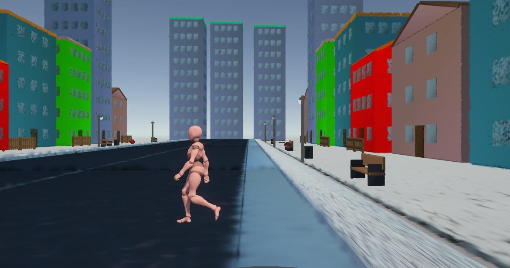

# 3D Gaussian Splats in Safety-Critical Pedestrian Detection

Final project for **Industrial Applications of Computer Vision**, Università degli Studi di Padova, A.A. 2025–26 (Prof. Michele Geronazzo).

A pedestrian stepping out in front of a car is rare and dangerous to collect in real life, so it is simulated. A synthetic, safety-critical driving scenario is built in Unity on top of procedurally generated 3D Gaussian-splat environments. A vehicle-mounted camera records pedestrians crossing the road, the frames are labeled with a model-assisted (auto-labeling) pipeline, and a single-class pedestrian detector (YOLOv8n) is trained without and with augmentation and compared against an augmented Faster R-CNN model on a fixed, held-out test split.



Example detection outputs (bounding boxes with confidence scores) are in [`results/ADAS_Project_drive/runs/detect/predict/`](./results/ADAS_Project_drive/runs/detect/predict/).

---

## Table of contents

1. [Team and contributions](#1-team-and-contributions)
2. [Problem definition and metrics](#2-problem-definition-and-metrics)
3. [Repository structure](#3-repository-structure)
4. [Setup and how to run](#4-setup-and-how-to-run)
5. [Unity environment](#5-unity-environment)
6. [Dataset](#6-dataset)
7. [Ground truth and annotation](#7-ground-truth-and-annotation)
8. [Training, evaluation and results](#8-training-evaluation-and-results)
9. [Third-party code, assets and licenses](#9-third-party-code-assets-and-licenses)
10. [AI and LLM usage](#10-ai-and-llm-usage)
11. [References and existing implementations](#11-references-and-existing-implementations)
12. [Known limitations and next steps](#12-known-limitations-and-next-steps)

---

## 1. Team and contributions

Each member contributed through their own GitHub account, so the commit history documents the individual work. Where work was done jointly, it is attributed to everyone involved.

| Member | GitHub | Main area |
| --- | --- | --- |
| **Ahmed Amr** | [`amr-medh4t`](https://github.com/amr-medh4t) | Part 1: Unity environment |
| **Zafar Umair** | [`wumairz`](https://github.com/wumairz) | Part 2: data collection in Unity, dataset creation |
| **Mohamed Youssef** | [`yusuf-unipd`](https://github.com/yusuf-unipd) | Part 3: auto-labeling, label verification, sorting, augmentation, training and evaluation |

### Ahmed Amr — Unity environment

- Built the Unity project (Unity **6000.5.6f1**, Universal Render Pipeline) and the main scene `Assets/Scenes/SampleScene.unity`.
- Imported the PromptSplat-generated environment objects (Gaussian splat plus collider) into `Assets/GaussianAssets/`, and placed every object in the scene by hand (street layout, camera view, where the pedestrian emerges).
- Integrated the Mixamo human model (a mesh) and its walking animation controller.
- Implemented pedestrian crossing behavior in `Assets/HumanPath.cs`: configurable `CrossStart`/`CrossEnd` endpoints, walking speed, and random start delay and speed.
- Integrated the car prefab and its manual driving script (`SimpleCarDrive.cs`), controlled with the keyboard arrows and the Unity inspector.
- Organized the project for reproducible setup (package manifest, lock file, `.gitignore`, `docs/unity-setup.md`).

### Zafar Umair — Data collection and dataset creation

- **Capture pipeline:** designed and implemented `TimeRecorder.cs`, a C# recorder using `Time.unscaledDeltaTime` and `ScreenCapture` that samples continuously at 10 Hz, both while the car is driving and while it is parked.
- **Storage management:** session-timestamped output (`run_YYYYMMDD_HHMMSS`) written outside `Assets/`, so cumulative captures are not lost when Unity re-imports assets.
- **Dataset creation:** collected the dataset from scratch inside the Gaussian-splat environment. Capture protocols cover variable-distance straight crossings, angled and curved approaches, and sidewalk clutter occlusions (benches, poles, buildings).
- **Negative samples:** collected pedestrian-free frames (empty roads, curb edges, turning maneuvers) to penalize false positives and phantom braking.
- **Dataset sorting (joint with Mohamed Youssef):** `training data sorter.py`.

### Mohamed Youssef — Labeling, training and evaluation

- **Auto-labeling:** `auto_label_pedestrians.py`, which generates preliminary single-class YOLO boxes with a pretrained YOLOv8m model (see [Section 7](#7-ground-truth-and-annotation)).
- **Label verification:** carried out the two-pass verification of the generated labels described in Section 7.
- **Dataset sorting and configuration (joint with Zafar Umair):** the sorter script (stratified, leakage-aware 80/10/10 split) and `data.yaml`.
- **Augmentation and training:** configured the online augmentation, trained the YOLOv8n runs (unaugmented and augmented) and the Faster R-CNN (ResNet-50 FPN) model on augmented data, in `train_and_evaluate.ipynb`.
- **Metrics and results:** computed precision, recall, mAP50, mAP50-95 and inference time; produced the plots and run artifacts in `results/ADAS_Project_drive/runs/`.

---

## 2. Problem definition and metrics

**Goal.** Detect pedestrians crossing in front of a vehicle in a safety-critical scenario, where a missed detection can lead to a collision and a false positive can trigger unnecessary braking.

| | |
| --- | --- |
| **Input** | A single RGB frame, 1920 × 1080, from a vehicle-mounted camera in the Unity scene. |
| **Output** | Zero or more bounding boxes for the single class `pedestrian`, each with a confidence score. |
| **Out of scope** | Braking or control logic, pedestrian tracking, distance or speed estimation, multi-class detection, and real-world (non-synthetic) imagery. |

**Metrics.** Standard detection metrics, so results are comparable with other work.

| Metric | Definition | Why it matters here |
| --- | --- | --- |
| IoU | Overlap of predicted and true box divided by their union | Decides whether a detection counts as correct |
| Precision | TP / (TP + FP) | Low precision means phantom braking |
| Recall | TP / (TP + FN) | Low recall means a missed pedestrian; the safety KPI of this project |
| F1 | Harmonic mean of precision and recall | One score for the balance of the two |
| mAP50 | Average precision when a hit needs IoU ≥ 0.5 | Does the model find the pedestrian at all |
| mAP50-95 | mAP averaged over IoU from 0.50 to 0.95 | Does it box tightly; box height drives distance estimation |
| Latency | Inference time per image, in ms | Reaction distance d = v × t |

---

## 3. Repository structure

```text
3D-Gaussian-Splats-in-Safety-Critical-Pedestrian-Detection_Ahmed-Mohamed-Zafar/
├── README.md
├── requirements.txt              Python dependencies
├── .gitignore
├── data.yaml                     YOLO dataset config (single class: pedestrian)
├── auto_label_pedestrians.py     Generates preliminary YOLO labels with a pretrained model
├── training data sorter.py       Builds the leakage-aware train/val/test split
├── train_and_evaluate.ipynb      Training, comparison and metrics
├── unity/                        Unity project (environment and capture)
│   ├── Assets/
│   │   ├── GaussianAssets/       Gaussian-splat scene assets (Git LFS)
│   │   ├── Azerilo/              Car model and SimpleCarDrive.cs
│   │   ├── Scenes/               SampleScene.unity
│   │   └── HumanPath.cs          Pedestrian crossing behavior
│   ├── Packages/                 manifest.json and packages-lock.json
│   └── ProjectSettings/
├── dataset/                      YOLO-format dataset (not versioned; see Section 6)
│   ├── images/{train,val,test}
│   └── labels/{train,val,test}
├── docs/
│   ├── unity-setup.md            Detailed Unity setup and handoff notes
│   ├── prompt-splat.md           PromptSplat documentation
│   └── samples/                  Sample images
└── results/
    └── ADAS_Project_drive/runs/  Training and validation artifacts, plots
```

`Library/`, `Logs/`, `UserSettings/` and build outputs are intentionally excluded; Unity regenerates them when the project is opened.

---

## 4. Setup and how to run

### Python environment (labeling, training and evaluation)

Training and evaluation of the YOLOv8n runs were done in Google Colab (NVIDIA T4 GPU); data preparation scripts were run locally.

| Component | Version |
| --- | --- |
| Python | 3.10 (Colab) / 3.11 (local scripts) |
| PyTorch | 2.2.0+cu121 |
| Torchvision | 0.17.0+cu121 |
| Ultralytics | 8.1.0 |
| OpenCV | opencv-python 4.9.0.80 |

```bash
pip install -r requirements.txt
```

### Pipeline

1. **Get the dataset.** Download the raw captured images from the Drive link in [Section 6](#6-dataset).
2. **Auto-label.** Generate preliminary pedestrian boxes for the pedestrian categories (YOLOv8m, class `person`, confidence above 0.30):
   ```bash
   python auto_label_pedestrians.py
   ```
   Set the input image folder and output label folder at the top of the script before running.
3. **Verify labels.** Apply the two-pass verification in Section 7.
4. **Build the split.** Run the sorter on the labeled images:
   ```bash
   python "training data sorter.py"
   ```
   The split parameters are constants at the top of the script (`SPLITS = {'train': 0.80, 'val': 0.10, 'test': 0.10}`, `GROUP = 10`, `random.seed(42)`); set the raw image/label folder and the output `dataset/` folder there as well.
5. **Train and evaluate.** Open and run `train_and_evaluate.ipynb`. It reads `data.yaml`, trains YOLOv8n (unaugmented and augmented) and Faster R-CNN (augmented), and writes metrics and plots to `results/ADAS_Project_drive/runs/`.

### Unity project (environment and capture)

1. Install Unity **6000.5.6f1**.
2. Clone the repository with Git LFS enabled (`git lfs install` before cloning).
3. Open the `unity/` folder in Unity Hub.
4. Open `Assets/Scenes/SampleScene.unity` and let Unity reimport assets and regenerate `Library/`.
5. Press Play to check the environment, pedestrian, car and camera.

The Gaussian-splat package is declared in [`unity/Packages/manifest.json`](./unity/Packages/manifest.json) with resolved dependencies in [`packages-lock.json`](./unity/Packages/packages-lock.json). More detail is in [`docs/unity-setup.md`](./docs/unity-setup.md).

### Inputs and outputs per stage

| Stage | Input | Output |
| --- | --- | --- |
| Unity environment | PromptSplat objects (splat + collider), car and pedestrian prefabs, path parameters | A scripted crossing event, ready for data collection |
| Data capture | The running Unity scene | Timestamped PNG frames in `TrainingDataset/` (project root) |
| Auto-labeling | PNG frames | Preliminary YOLO `.txt` labels |
| Verification | Preliminary labels | Verified labels (empty file for negatives) |
| Sorting | Images and verified labels | `dataset/images|labels/{train,val,test}` |
| Training / evaluation | `data.yaml` and the dataset | Weights, metrics, plots, comparison table |

---

## 5. Unity environment

**Scene components**

- Gaussian-splat environment in [`unity/Assets/GaussianAssets/`](./unity/Assets/GaussianAssets), about 345 MB of binary data tracked with Git LFS. Everything except the pedestrian is a splat; the pedestrian is a mesh.
- Pedestrian: [`HumanPath.cs`](./unity/Assets/HumanPath.cs) moves the Mixamo character between configurable `CrossStart` and `CrossEnd` points with a random start delay and controlled walking speed.
- Car: manually driven with the Unity horizontal and vertical input axes (keyboard arrows) via [`SimpleCarDrive.cs`](./unity/Assets/Azerilo/Car%20Model%20No.1201%20Asset/Prefab/SimpleCarDrive.cs), so the operator can vary route, speed and viewpoint, approach the crossing, and brake.

**Gaussian-splat generation.** The splats were generated locally with **PromptSplat**, a private GUI application developed with Ahmed Mounir (external collaborator, not a member of this group). It turns a text prompt into a procedurally built Blender scene and exports two aligned files: a Gaussian-splat point cloud (`scene_splat.ply`, the visuals) and a simplified mesh (`collider.glb`, the physics). It does not train a splat from photographs, so the world is static and procedurally generated, not a real scan. It is not publicly released, and it is only a scene-generation step, not the detector being evaluated. See [`docs/prompt-splat.md`](./docs/prompt-splat.md).

**Capture setup**

| Parameter | Value |
| --- | --- |
| Resolution | 1920 × 1080 (Full HD, Game View buffer) |
| Field of view | 60° vertical, perspective projection |
| Camera mount | Vehicle hood, Y = 1.2 m, Z = 0.3 m |
| Capture rate | 10 Hz (one frame every 0.1 s of unscaled time) |
| Script | `TimeRecorder.cs`, attached to `Main Camera`, using `ScreenCapture.CaptureScreenshot()` |
| Output folder | `TrainingDataset/` in the project root (outside `Assets/`) |
| File naming | `run_YYYYMMDD_HHMMSS_frame_XXXXX.png` (session timestamp + 5-digit index) |

**Capture protocol**

- Stationary captures at distances from 1 m to 25 m, recording full crossing trajectories at different pixel scales.
- Straight-ahead driving runs approaching the crossing.
- Rotated camera perspectives (curved approaches, off-angle road alignments).
- Empty-road passes (full road traverse, turnarounds, curb alignments) with no pedestrian, for negative samples.

**Lighting and clutter.** Directional sunlight with Gaussian-splat ambient reflections; background clutter includes benches, trees, light poles and buildings.

---

## 6. Dataset

The evaluation dataset was **created entirely from scratch** inside the Unity Gaussian-splat environment. No pre-existing dataset is used for evaluation. COCO-pretrained weights are used only as initialization for fine-tuning.

**Download.** The full dataset is not stored in Git (images and labels are excluded via `.gitignore`):
<https://drive.google.com/drive/folders/1Ba6KrsNfvHEkJf9REvHP4OQro6xuFSt8?usp=drive_link> (anyone with the link can view and download).

**Composition.** The sorted dataset has 969 frames: **613** with a pedestrian (`pedestrian`, `pedestrian_rotated`) and **356** background frames (`empty`, `Distractors`, `car_near_sidewalk`), i.e. 36.7% of the frames contain no pedestrian. The capture log lists the recorded scenarios as follows (971 frames; the two-frame difference with the sorted dataset is not broken down by category):

| Scenario | Frames | Share | Label |
| --- | ---: | ---: | --- |
| Direct in-path crossings (straight camera, 1–25 m) | 462 | 47.6% | Pedestrian box |
| Angled / rotated viewpoints (curved approaches) | 152 | 15.7% | Pedestrian box |
| Distractors and clutter (sidewalk, benches, poles) | 75 | 7.7% | Empty file |
| Empty road, no pedestrian | 282 | 29.0% | Empty file |

Background frames are stored as 0-byte label files, which keeps the negative distribution without creating false annotations.

**Split.** The sorter applies a **stratified, leakage-aware 80/10/10** train/validation/test split, with seed 42, identical for every model:

- **Stratified:** the split is done separately for each of the five categories, so each split keeps the dataset's mix of scenarios.
- **Leakage-aware:** frames are captured at 10 Hz, so neighbors are near-duplicates. Each category is sorted in frame order and cut into groups of 10 consecutive frames; whole groups are shuffled and assigned to train, validation or test, so a group never straddles two splits.
- **Sizes:** the test split holds 101 images with 58 pedestrians; the validation split holds about 56 pedestrians. The remaining ~80% of the frames form the training set.
- **Fixed evaluation:** validation and test never change between experiments, so every model is scored on exactly the same images.

**Folder layout (YOLO format).** Images and labels are mirrored by split, with one `.txt` per image and the same filename stem (`0 <x_center> <y_center> <width> <height>`, normalized to [0, 1]). `data.yaml` defines a single class, `pedestrian` (id 0).

---

## 7. Ground truth and annotation

The ground truth is the set of correct boxes that predictions are compared against. The labels were **not drawn manually**: they were generated automatically and then verified.

- **Auto-labeling:** `auto_label_pedestrians.py` runs a pretrained Ultralytics YOLOv8m detector on the pedestrian-category frames, keeps only the `person` class with confidence above 0.30, and writes the preliminary boxes as the single class `pedestrian`.
- **Format:** single-class normalized YOLO, `0 <x_center> <y_center> <width> <height>` with values in [0, 1].
- **Negative frames:** empty (0-byte) `.txt` files. Empty-road, distractor and car-near-sidewalk categories are never auto-labeled.
- **Auto-labeling and verification:** by Mohamed Youssef.

**Verification (two passes)**

1. **Label coverage check.** Scripted checks (PowerShell) that every pedestrian image has a populated label file and every negative image has an empty one.
2. **Visual check.** Review of the generated boxes against the images to keep only valid pedestrian annotations.

The same label files serve two roles on different images: on the training split they are the teaching signal (the loss compares predictions with them), and on the validation and test splits they are the answer key used to score predictions. Because the ground truth is model-generated, it is only as good as YOLOv8m and may favor YOLO-family detectors; see [Section 12](#12-known-limitations-and-next-steps).

---

## 8. Training, evaluation and results

### Models compared

All models are initialized from COCO-pretrained checkpoints, fine-tuned on the single-class dataset, and evaluated on the same fixed split.

| Model | Type | Initialization | Training data | Role |
| --- | --- | --- | --- | --- |
| YOLOv8n, run 1 | One-stage | `yolov8n.pt` | Unaugmented | Baseline (default configuration) |
| YOLOv8n, run 2 (`yolov8n_augmented`) | One-stage | `yolov8n.pt` | Augmented | Candidate for the car |
| Faster R-CNN, ResNet-50 FPN | Two-stage | `fasterrcnn_resnet50_fpn` (torchvision) | Augmented | Accuracy reference |

Faster R-CNN uses a ResNet-50 backbone, a region proposal network that suggests candidate boxes, and a second stage that classifies and refines each one: accurate, but the work is repeated per region. YOLOv8n divides the image into a grid and predicts boxes and confidence scores in a single pass; the *n* is nano, the smallest version (about 3 million parameters). Faster R-CNN is compared directly against YOLOv8n run 2, since both are trained on augmented data.

### YOLOv8n training setup

| Parameter | Value | Why |
| --- | --- | --- |
| Model | YOLOv8n | Lowest latency, enough capacity for one class |
| Initial weights | COCO pretrained | Under 800 training images are too few to learn features from scratch |
| Input size | 640 × 640 | Standard YOLO size; small distant pedestrians stay visible |
| Epochs | 50 | Losses and mAP flatten by then |
| Batch size | 16 | Stable gradients, fits GPU memory |
| Optimizer | auto (AdamW), lr ≈ 0.002, linear decay | Suits short fine-tuning |
| Weight decay | 0.0005 | Regularization against overfitting |
| Seed | 0, deterministic | Reproducible runs |

**Augmentation (online, training split only).** New random variants are drawn every epoch and nothing is stored on disk: HSV jitter (0.015 / 0.7 / 0.4) for lighting robustness; rotation ±10°, translation 0.1, scale 0.5 and horizontal flip 0.5 for viewpoint and position; mosaic 1.0 (four frames per tile, switched off for the last 10 epochs) and random erasing 0.4 for new scales and occlusions.

### Results

| Model | Split | mAP50 | mAP50-95 | Precision | Recall | Latency |
| --- | --- | ---: | ---: | ---: | ---: | ---: |
| YOLOv8n, run 1 (unaugmented) | Val / Test | 0.994 / 0.992 | not reported | not reported | not reported | not reported |
| YOLOv8n, run 2 (augmented) | Test | 0.9918 | 0.8295 | 0.979* | 0.982* | 7.2 ms |
| Faster R-CNN (augmented) | Test (101 images) | 0.9803 | 0.8290 | 0.905 | 0.983 (57 of 58) | 186.6 ms |

\*Precision and recall of YOLOv8n run 2 are validation values at the final epoch; the Faster R-CNN values are on the test split, so they are not directly comparable. Faster R-CNN F1 on the test split is 0.942. Latency is inference time per image at batch size 1.

**Reaction distance.** The car keeps moving while the detector computes, so latency is a safety parameter: d = v × t. At 50 km/h (13.9 m/s), YOLOv8n travels 0.10 m before the detection is available and Faster R-CNN 2.59 m, a difference of 2.49 m (more than half a car length), counting the detector delay only.

**Interpretation**

- Both models reach very high mAP50 (about 0.98–0.99). mAP50-95, which measures box tightness, is the more telling number, and there the two are tied (0.8295 vs 0.8290).
- YOLOv8n is about 26× faster (7.2 ms vs 186.6 ms) at the same accuracy, so it is the model selected for a real-time braking loop.
- Faster R-CNN has comparable recall but lower precision (about one detection in ten is a false alarm).
- The unaugmented and augmented YOLOv8n runs are essentially tied on mAP50 on this dataset.
- Training curves (box, class and dfl losses) fall steadily on both training and validation, and the precision-recall curve stays near 1.0 up to about 0.98 recall; empty frames produce no boxes.
- No parameter-space analysis was carried out. The comparison covers two architectures and one augmentation change on YOLOv8n.
- Training and validation artifacts, including PR and F1 curves and comparison charts, are in [`results/ADAS_Project_drive/runs`](./results/ADAS_Project_drive/runs).

### Design choices

| Decision | Chosen | Alternative | Why |
| --- | --- | --- | --- |
| Detector | YOLOv8n (one-stage) | Faster R-CNN (two-stage) | Same test accuracy, about 26× faster |
| Model size | Nano | Small / medium | Lowest latency; mAP50 already 0.99 |
| Initialization | COCO pretrained | Train from scratch | Under 800 training images |
| Augmentation | Online, every epoch | Pre-made 10,000 copies | Fresh variants, no storage, no leakage into val/test |
| Split | Stratified, 10-frame groups | Random single frames | 10 Hz neighbors are near-duplicates |
| Negatives | 356 frames, empty labels | Positives only | Teaches what is not a pedestrian |
| Labels | Auto-labeled (YOLOv8m) | Hand-drawn boxes | Fast and consistent; stated as a limitation |

---

## 9. Third-party code, assets and licenses

| Component | Source | License / terms | Notes |
| --- | --- | --- | --- |
| Unity 6000.5.6f1 and packages | [Unity](https://unity.com/) | Unity terms; see `manifest.json` | |
| UnityGaussianSplatting | [aras-p/UnityGaussianSplatting](https://github.com/aras-p/UnityGaussianSplatting) | MIT | Gaussian-splat rendering in Unity |
| Human model and walking animation | [Mixamo](https://www.mixamo.com/) | Adobe Mixamo terms | Redistribution confirmed by the team |
| Car model "Car for Games Unity" | [Sketchfab](https://sketchfab.com/3d-models/car-for-games-unity-4d9bbde680fe41349d7ad2b4672a720b), artist **Azerilo** | License on the Sketchfab asset page | In `Assets/Azerilo/` |
| Ultralytics YOLOv8 (incl. `yolov8n.pt`, `yolov8m.pt`) | [ultralytics/ultralytics](https://github.com/ultralytics/ultralytics) | AGPL-3.0 | Auto-labeling, training and inference |
| PyTorch / Torchvision | [pytorch.org](https://pytorch.org/) | BSD-3-Clause | Faster R-CNN, training |
| OpenCV | [opencv.org](https://opencv.org/) | Apache-2.0 | Image processing |

---

## 10. AI and LLM usage

| Tool | Where | For what |
| --- | --- | --- |
| **PromptSplat** (private, developed with Ahmed Mounir) | Unity environment | Local generation of the Gaussian-splat scene assets from project-specific prompts |
| **Claude** | Unity code (human and car scripts) | Code assistance for the pedestrian and car behavior |
| **Claude and Gemini** | `TimeRecorder.cs` | Implementing the `Time.unscaledDeltaTime` accumulator and external path resolution relative to `Application.dataPath` |
| **Gemini and GitHub Copilot** | `training data sorter.py`, `auto_label_pedestrians.py` | Sequence-aware prefix grouping to prevent temporal leakage; auto-labeling script |
| **GitHub Copilot** | Repository | Repository organization, documentation and code review |
| **Claude** | `README.md` | Restructuring and rewording this document |

The `yolov8m.pt` detector used for auto-labeling is a pretrained model, listed in Section 9. All generated assets and code were integrated, tested and reviewed by the team, and the team can explain every design choice.

---

## 11. References and existing implementations

**Papers**

1. B. Kerbl, G. Kopanas, T. Leimkühler, G. Drettakis. *3D Gaussian Splatting for Real-Time Radiance Field Rendering.* ACM Transactions on Graphics, 2023. <https://arxiv.org/abs/2308.04079>
2. S. Ren, K. He, R. Girshick, J. Sun. *Faster R-CNN: Towards Real-Time Object Detection with Region Proposal Networks.* NeurIPS 2015. <https://arxiv.org/abs/1506.01497>
3. G. Jocher, A. Chaurasia, J. Qiu. *Ultralytics YOLOv8.* 2023. <https://github.com/ultralytics/ultralytics>
4. T.-Y. Lin et al. *Microsoft COCO: Common Objects in Context.* ECCV 2014. <https://arxiv.org/abs/1405.0312>

**Existing implementations and models**

- [aras-p/UnityGaussianSplatting](https://github.com/aras-p/UnityGaussianSplatting)
- Ultralytics `yolov8n.pt` and `yolov8m.pt` (COCO-pretrained)
- Torchvision `fasterrcnn_resnet50_fpn` (COCO-pretrained)

**Positioning of this work**

| | |
| --- | --- |
| **Reused** | The Unity Gaussian-splat renderer, PromptSplat-generated objects, Mixamo and Sketchfab assets, COCO-pretrained YOLOv8 and Faster R-CNN weights, the Ultralytics and torchvision training APIs, `yolov8m.pt` for auto-labeling. |
| **Adapted** | Conversion and import of the PromptSplat objects into Unity; detectors fine-tuned to a single `pedestrian` class; YOLOv8n trained without and with augmentation; Faster R-CNN trained with augmentation. |
| **Created by the team** | The Unity scene layout, pedestrian and car behavior, the capture recorder, the dataset, the auto-labeling and verification pipeline, the leakage-aware sorter, the augmentation setup, and the evaluation and comparison. |

---

## 12. Known limitations and next steps

**Limitations**

- **Labels are model-generated.** Ground truth comes from an auto-labeling pass with YOLOv8m followed by verification, not from independent manual annotation. Evaluating YOLO detectors against YOLO-made labels may overstate their accuracy, and may partly explain the near-saturated mAP50 (~0.99).
- **Small test set.** The test split has 58 pedestrians (the validation split about 56), so a single miss moves recall by about 1.7 points.
- **Synthetic, single-scene data.** All frames come from one procedurally generated splat world with directional sunlight and a single mesh pedestrian, so lighting, weather and appearance variety are low, and there is no validation on real-world footage. The splat world is static and not a real scan.
- **Partial leakage control.** Frames are sampled at 10 Hz and grouped in blocks of 10 (one second), but a crossing lasts longer, so frames from the same crossing can still fall in different splits. Splitting by whole crossing sequence would be stricter.
- **Limited comparison.** Two architectures and one augmentation change on YOLOv8n; no parameter-space or ablation study, no traditional (non-deep-learning) method, and a single run per model without repeated seeds.
- The work covers detection only; no braking logic, tracking or distance estimation is implemented.
- The Gaussian-splat package is fetched from an external Git repository, and the large splat assets need Git LFS or external storage.
- PromptSplat is not publicly released, so the splat assets cannot be regenerated from this repository alone.

**Next steps**

- Test on the 400 unseen edge-case frames, then on real footage.
- Run the exported ONNX model inside the Unity automatic-emergency-braking loop.
- Hand-label a subset of the test set to check the model-generated ground truth, and add a traditional baseline (e.g. HOG + SVM) and an off-the-shelf COCO YOLO baseline.
